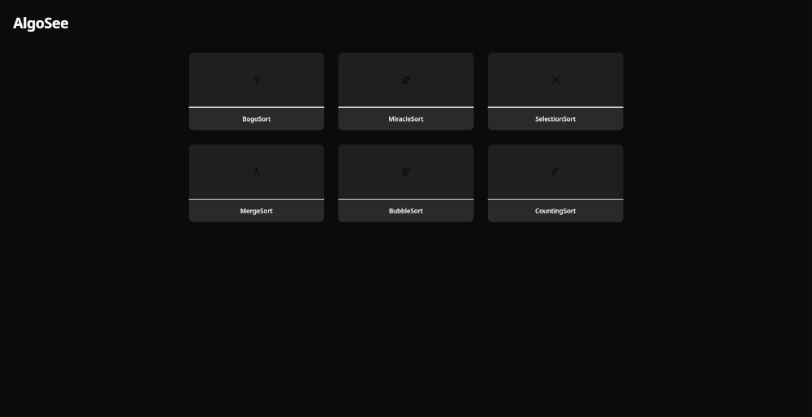
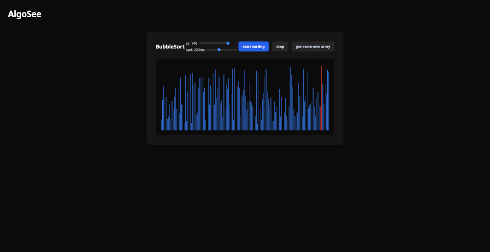

# algosee

**A 0815 Algorithm Visulizer**

*© 2026 MrHunor, siryanni (as equals) · GPLv3*

## Demo:
    

## Features:
- **Choose between 6 sorting algorithms**
- **View an overview of the algorithm inclduing summary, time complexity and space complexity**
- **Simulate sorting an array from sizes 3 to 140 in varying speeds with single swap animations**
- **Make curl requests to the server yourself**

## Algorithms
The implementation will roughly follow the order given in the table.  

### Sorting

| Algorithm | Status |
|-----------|--------|
| Selection | Supported |
| Bogo      | Supported |
| Bubble    | Supported |
| Quick     | Supported |
| Merge     | Supported |
| Counting  | Supported | 
| Cycle Sort | Supported |
| Radix Sort | TBD |
| Intro Sort | TBD |  

-> More ideas? Suggest them [here](https://github.com/MrHunor/algosee/issues)

### Pathfinding 

| Algorithm | Status |
|-----------|--------|
| Breadth first search (BFS) | Supported |
| Dijkstra | Supported |
| Depth first search (DFS) | Supported |
| Bidirectional Breadth first search (BIBFS) | Supported |
| A* | Supported | 
| Greedy Best-First-Search (GBFS) | Supported |
| Jump point search (JPS) | TBD |
| D* | TBD |
| Bellman-Ford | TBD |
| Floyd-Warshall | TBD |  

-> More ideas? Suggest them [here](https://github.com/MrHunor/algosee/issues)

## Test it out yourself!
Click [here](https://mrhunor.github.io/algosee) to test if out yourself!
To test the backend via a curl command [go here](#to-test-the-backend-online-linux).

## Tech Stack:
- **Frontend:** HTML,CSS,JS
- **Backend:** C++
- **Building:** CMAKE, Ninja
- **Package Managment:** conan
- **Hosting:** Github Pages (Frontend), Render (Backend) 

## Plans: 
Current plans invlove Streaming and more, have a look [here](https://github.com/MrHunor/algosee/milestones).

## Workflow:
1. Currently a visitor on https://mrhunor.github.io/algosee is shown the newest version of the fronend (./frontend).
2. Via clicking on any algorithm they are sending a status request to the backend server (algosee.onrender.com), depending on its outcome the frontend displays a loading screen in the time of the server waking up.
3. By pressing the "start" button on the viszulizer.html they are sending a html POST request [like this](#To-test-the-backend-sorting-online-(linux)) to the backend.
4. The backend extracts the algorithm Name from the URL and performs the sorting.
5. The backend return the sorted array, a set of instructions on how to visulise the sorting and metadata like backend version and time in nanoseconds.
6. The frontend visulises the instructions returned by the backend.   

 
 
 
 
 
 
   

# License(s)
This Project is published under the GPL3 License which you can find [here](./LICENSE.md).  
Furthermore this project also includes code from other repositorys, you can find their licenses [here](./THIRD_PARTY_LICENSES.md).  
We thank every author and contribtor of those repositories from :heart: , without their work this project woudn't have been possible. 

# AI usage disclosure:
I, **@MrHunor**, have used AI for explaining what do to when i didn't know anymore, as well as when i wanted to implement something but didn't know how or for scanning the codebase for bugs and possible enhancements. I've also used AI Audits, such as coderabbit on PRs.
I, **@siryanni**, main usage of AI was during major bughunts, as the codebase has slowly gotten pretty big.
                  other uses include: -image generation
                                      -help with concept mapping
                                      -help with code cleanup
---                                   -said coderabbit made Issues           
For anyone looking to contribute we would ask them to follow the line we provided 

# Big :heart: to the following:
- [Render](https://render.com/), for their free tier hosting which the online Backend relies on.
